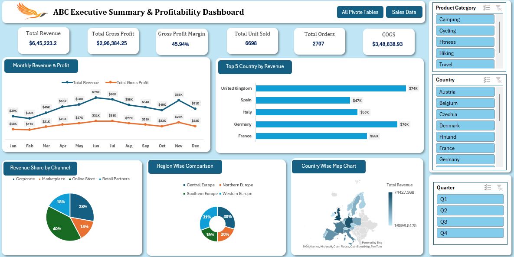

Excel_sales_Dashboard
# ABC Executive Summary & Profitability Dashboard

## Project Overview
This project presents an interactive Excel dashboard designed to analyze sales performance and profitability. It provides insights into revenue, gross profit, profit margin, orders, and sales performance across different countries, regions, and product categories.

## Tools Used
- Microsoft Excel
- Pivot Tables
- Pivot Charts
- Slicers
- Data Visualization

## Dashboard Features
- Total Revenue
- Total Gross Profit
- Gross Profit Margin
- Total Units Sold
- Total Orders
- Cost of Goods Sold (COGS)
- Monthly Revenue & Profit Analysis
- Top 5 Countries by Revenue
- Revenue Share by Channel
- Region-wise Comparison
- Country-wise Map Chart
- Interactive Slicers for Product Category, Country, and Quarter

## Key Insights
- Analyze monthly revenue and gross profit trends.
- Identify top-performing countries.
- Compare revenue contribution across sales channels.
- Understand regional sales performance.
- Explore sales data using interactive filters.

## Dashboard Preview

## Project Files
- Excel Dashboard (.xlsx)
- Dashboard Screenshot (.png)
